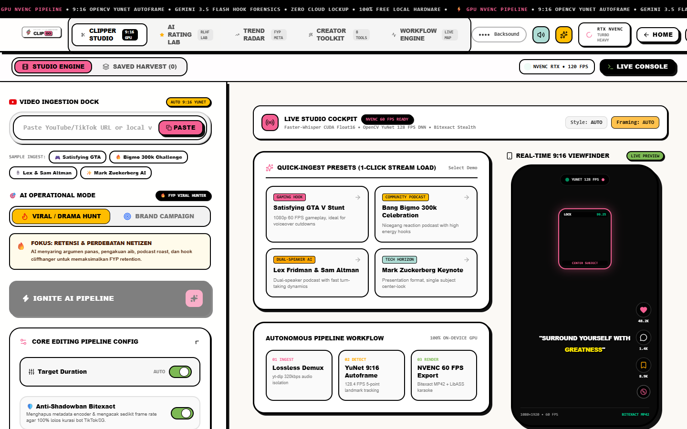

<!--
  LANCIUY // AFTER HOURS EDITION
  Layout notes for maintainers:
  - GitHub strips every style="" attribute, so structure relies only on <table>, align, width and height.
  - All media is self-hosted under docs/assets/ so the page never depends on ISP-filtered CDNs (Giphy, Tenor, Vercel).
  - lanciuy_ascii.svg is generated by vector geometry (not <text>) so the logo stays aligned without webfonts.
-->

<div align="center">


<a href="https://github.com/Lanciuy">
  
</a>

<details>
<summary><sub>raw ascii</sub></summary>

```
██╗      █████╗ ███╗   ██╗ ██████╗██╗██╗   ██╗██╗   ██╗
██║     ██╔══██╗████╗  ██║██╔════╝██║██║   ██║╚██╗ ██╔╝
██║     ███████║██╔██╗ ██║██║     ██║██║   ██║ ╚████╔╝
██║     ██╔══██║██║╚██╗██║██║     ██║██║   ██║  ╚██╔╝
███████╗██║  ██║██║ ╚████║╚██████╗██║╚██████╔╝   ██║
╚══════╝╚═╝  ╚═╝╚═╝  ╚═══╝ ╚═════╝╚═╝ ╚═════╝    ╚═╝
```

</details>


<br/>


<br/>


<br/><br/>

<a href="https://github.com/Lanciuy"></a>


<br/><br/>

<!-- ============================== HERO MOOD ============================== -->


<sub>🎧 NOW PLAYING · THE WEEKND — BLINDING LIGHTS · 171 BPM · 03:00 AM</sub>

<br/><br/>

<!-- ============================== PERSONA TRIAD ============================== -->

<table>
  <tr>
    <td width="36%" align="center" valign="top">
      
      <br/>
      <b>⚖️ VERDICT</b>
      <br/>
      <sub>GUILTY OF 3AM COMMITS.<br/>SENTENCE: SHIP IT ANYWAY.</sub>
    </td>
    <td width="28%" align="center" valign="top">
      
      <br/>
      <b>🐈‍⬛ NIGHT SHIFT</b>
      <br/>
      <sub>Official QA department.</sub>
    </td>
    <td width="36%" valign="top">
      <h3>🩸 whoami</h3>
      <ul>
        <li>Sovereign AI &amp; systems architect</li>
        <li>Everything runs on <b>local silicon</b>, zero cloud rent</li>
        <li>CUDA FP16 · NVENC 60 FPS · FastAPI · React</li>
        <li>Builds best between <b>00:00 and 04:00</b></li>
      </ul>
      
      
    </td>
  </tr>
</table>


<!-- ============================== FLAGSHIP ============================== -->

<h3>⚡ TAKE MY HAND // FLAGSHIP</h3>


<br/><br/>

<a href="https://github.com/Lanciuy/CLIPGO">
  
</a>

<b>CLIPGO 6.0</b> · autonomous 9:16 video factory · 12 s NVENC export · 100% local GPU


<br/><br/>

<table>
  <tr>
    <td align="center" width="25%"><h2>12s</h2><sub>NVENC 60 FPS EXPORT</sub></td>
    <td align="center" width="25%"><h2>128.4</h2><sub>YUNET DNN FPS</sub></td>
    <td align="center" width="25%"><h2>$0.00</h2><sub>CLOUD COST / MO</sub></td>
    <td align="center" width="25%"><h2>100%</h2><sub>LOCAL GPU SILICON</sub></td>
  </tr>
</table>


<!-- ============================== FLEET ============================== -->

<h3>🌌 THE FLEET</h3>

<table>
  <tr>
    <td width="50%" valign="top">
      <h4>🧾 <a href="https://github.com/Lanciuy/BONSNAP">BONSNAP</a></h4>
      <sub>Multimodal receipt OCR with Gemini Vision and a Groq agent.</sub>
      <br/><br/>
      
      
      
    </td>
    <td width="50%" valign="top">
      <h4>🌌 <a href="https://github.com/Lanciuy/CLINK">CLINK</a></h4>
      <sub>4-tier stealth downloader with Real-ESRGAN upscaling.</sub>
      <br/><br/>
      
      
      
    </td>
  </tr>
  <tr>
    <td width="50%" valign="top">
      <h4>⛩️ <a href="https://github.com/Lanciuy/WARNET_SYSTEM">WARNET_SYSTEM</a></h4>
      <sub>Esports net-cafe monorepo: Fastify server, Electron kiosk client.</sub>
      <br/><br/>
      
      
      
    </td>
    <td width="50%" valign="top">
      <h4>🧠 MEMORY MCP</h4>
      <sub>Cognitive graph and architecture index for coding agents.</sub>
      <br/><br/>
      
      
      
    </td>
  </tr>
</table>


<!-- ============================== ARSENAL ============================== -->

<h3>🎛️ ARSENAL</h3>


<br/>


<br/>


<br/><br/>

<!-- ============================== TELEMETRY ============================== -->

<h3>📊 TELEMETRY</h3>

<table>
  <tr>
    <td width="55%" align="center"></td>
    <td width="45%" align="center"></td>
  </tr>
</table>


<!-- ============================== END OF SHIFT ============================== -->

<br/>

```bash
git clone https://github.com/Lanciuy/CLIPGO.git && cd CLIPGO && python main.py
```


<sub>zzz // end of shift · engineered after hours on local silicon 🩸</sub>

<br/><br/>

<a href="https://github.com/Lanciuy/CLIPGO"></a>
<a href="mailto:contact@lanciuy.dev"></a>

</div>
