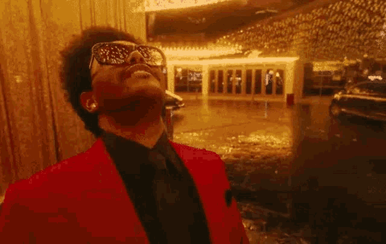
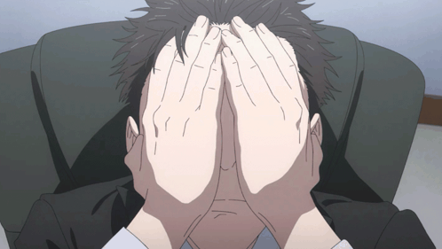
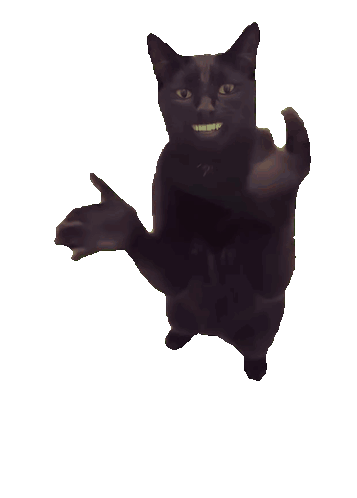
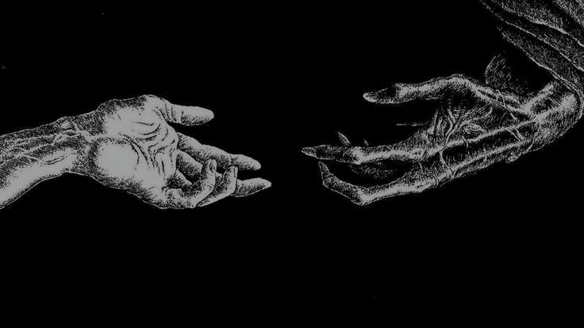
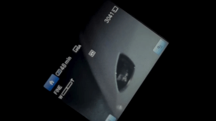
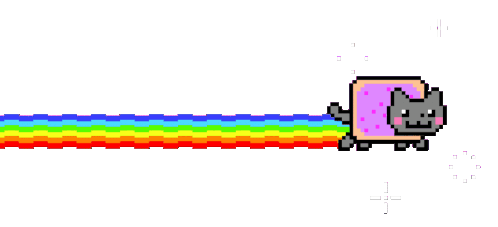

<!--
  LANCIUY // AFTER HOURS EDITION (PERSONAL PROFILE OVERVIEW)
  - Pure personal branding, skillset & nocturnal developer vibes.
  - Zero project oversharing / zero repo links.
  - 100% self-hosted assets under ./assets/ without external CDN dependence.
-->

<!--
  HIDDEN RAW ASCII MATRIX:
  ██╗      █████╗ ███╗   ██╗ ██████╗██╗██╗   ██╗██╗   ██╗
  ██║     ██╔══██╗████╗  ██║██╔════╝██║██║   ██║╚██╗ ██╔╝
  ██║     ███████║██╔██╗ ██║██║     ██║██║   ██║ ╚████╔╝ 
  ██║     ██╔══██║██║╚██╗██║██║     ██║██║   ██║  ╚██╔╝  
  ███████╗██║  ██║██║ ╚████║╚██████╗██║╚██████╔╝   ██║   
  ╚══════╝╚═╝  ╚═╝╚═╝  ╚═══╝ ╚═════╝╚═╝ ╚═════╝    ╚═╝   
-->

 

 

  

  

<!-- ============================== HERO MOOD ============================== -->

  

<!-- ============================== PERSONA TRIAD ============================== -->

<table>
  <tr>
    <td width="34%" align="center" valign="top">
      
       
      <b>⚖️ THE VERDICT</b>
       
      Literally guilty ngoding subuh. Sentence: push ke production no matter what.
    </td>
    <td width="28%" align="center" valign="top">
      
       
      <b>🐈‍⬛ 3 AM COPILOT</b>
       
      Emotional support pas nemu bug absurd pas tengah malem.
    </td>
    <td width="38%" valign="top">
      <h3>🩸 whoami &amp; vibes</h3>
      <ul>
        <li>Dev nocturnal yang mostly <b>peak productivity jam 12 malem ke atas</b>.</li>
        <li>Lowkey <b>allergic sama cloud bill</b> yang boncos, so heavy workloads mending gas di local silicon.</li>
        <li>Lebih demen ngulik <b>backend, AI automation, and high-performance pipelines</b> daripada debat styling.</li>
        <li>Pragmatic over hype: yang penting <b>kenceng, enteng, dan zero bloat</b>.</li>
      </ul>
      
      
      
    </td>
  </tr>
</table>

<!-- ============================== SKILLSET & MINDSET ============================== -->

<h3>⚡ WHAT I DO &amp; HOW I COOK</h3>

  

<table>
  <tr>
    <td width="50%" valign="top">
      <h4>🛠️ Daily Driver &amp; Focus Area</h4>
      

        Gue fokus di arsitektur sistem yang reliable dan snappy. Dari ngeracik background workers, pipeline media processing, sampe orchestration model AI lokal yang efisien.
      

      <ul>
        <li><b>Backend &amp; Systems</b>: FastAPI, Node.js, Python, WebSocket realtime, async multiprocessing.</li>
        <li><b>Local AI &amp; Media</b>: PyTorch, CUDA FP16, OpenCV vision tracking, Faster-Whisper STT, NVENC hardware acceleration.</li>
        <li><b>Frontend</b>: React, TypeScript, Tailwind, Framer Motion buat UI yang kerasa fluid dan gak kaku.</li>
      </ul>
    </td>
    <td width="50%" valign="top">
      <h4>🧪 Recent Builds &amp; Playground</h4>
      

        Beberapa hal yang sempet gue racik belakangan ini (purely buat testing limits dan explore tech stack baru, zero oversharing):
      

      <ul>
        <li><b>Video Automation Engine</b> — Pipeline clipping &amp; face-tracking video otomatis berbasis hardware encoder.</li>
        <li><b>Multimodal OCR Agent</b> — Document &amp; receipt parser via vision AI + reasoning gateway.</li>
        <li><b>Stealth Downloader</b> — Media isolation &amp; upscaler toolchain.</li>
        <li><b>Cognitive Tools</b> — Graph indexer &amp; memory system buat AI agent orchestration.</li>
      </ul>
    </td>
  </tr>
</table>

<!-- ============================== ARSENAL ============================== -->

<h3>🎛️ WORKSTATION SILICON &amp; TECH STACK</h3>

 

 

  

<!-- ============================== TELEMETRY ============================== -->

<h3>📊 TELEMETRY &amp; COMMIT MATRIX</h3>

<table>
  <tr>
    <td width="55%" align="center"></td>
    <td width="45%" align="center"></td>
  </tr>
</table>

<!-- ============================== END OF SHIFT ============================== -->

 

 

zzz // shift beres. waktunya matiin terminal dan touch grass sejenak. catch you on the next midnight session. 🩸⚡

  

